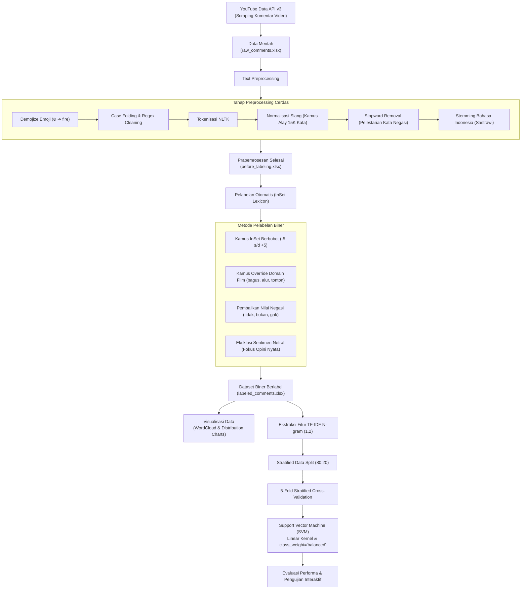

# 🎬 Analisis Sentimen Komentar YouTube Film "Jumbo"

[](https://www.python.org/)
[](https://scikit-learn.org/)
[](https://www.nltk.org/)
[](https://opensource.org/licenses/MIT)

> **Judul Penelitian**: *ANALISIS SENTIMEN KOMENTAR PADA PLATFORM YOUTUBE TENTANG FILM JUMBO MENGGUNAKAN ALGORITMA SUPPORT VECTOR MACHINE (SVM) DAN METODE INSET LEXICON*

Proyek ini merupakan implementasi *end-to-end* analisis sentimen berbasis **Machine Learning Tradisional** untuk mengukur polaritas opini penonton (Positif vs Negatif) terhadap teaser/trailer resmi film animasi Indonesia **"Jumbo"** di YouTube.

---

## 📌 Ringkasan Proyek

Film animasi *"Jumbo"* merupakan salah satu karya animasi layar lebar Indonesia yang paling dinantikan. Melalui kolom komentar di YouTube, penonton memberikan beragam respon mulai dari pujian terhadap kualitas visual render hingga kritik terhadap alur cerita.

Proyek ini mengolah ribuan komentar penonton menggunakan pipeline Natural Language Processing (NLP) bahasa Indonesia yang komprehensif, pelabelan otomatis berbasis kamus leksikon berbobot (*InSet Lexicon*), dan pemodelan klasifikasi biner menggunakan algoritma **Support Vector Machine (SVM)** dengan pembobotan kelas seimbang (*class-weighted*).

---

## ⚙️ Alur Kerja Sistem (Pipeline Architecture)



---

## 🚀 Keunggulan Metodologi & Fitur

1. **Demojize Emoji**: Emoji penonton (seperti 🔥, ❤️, 😭, 🤮) tidak dihapus sembarangan, melainkan dikonversi ke teks agar sinyal emosional penonton tetap terbaca oleh model.
2. **Normalisasi Kosakata Gaul (Slang)**: Memadukan kamus 15.000 kata alay (`kamus_alay.csv`) serta aturan morfologi gaul (seperti `nge-...-in` ➔ `ngebosenin` menjadi `bosan`).
3. **Pelestarian Kata Negasi**: Kata sanggahan (*tidak*, *bukan*, *jangan*, *kurang*, *gak*) dilindungi dari pembersihan stopword agar kalimat *"tidak bagus"* tidak tertelan menjadi *"bagus"*.
4. **Koreksi Konteks Leksikon (Domain Override)**: Mengoreksi anomali kata pada kamus InSet umum (seperti kata `bagus` yang salah terdaftar bernilai -4 di InSet asli, serta menetralkan kata teknis film seperti `alur`, `adegan`, `tonton`).
5. **Klasifikasi Biner Berkualitas**: Menghilangkan kelas netral (skor 0) yang kabur, sehingga model memfokuskan batas keputusannya pada sentimen nyata penonton: **Positif vs Negatif**.
6. **Bebas Manipulasi SMOTE**: Menggunakan penalti `class_weight='balanced'` yang terbukti secara sains data jauh lebih stabil untuk data teks berdimensi tinggi dibanding SMOTE sintetis.

---

## 📊 Hasil Evaluasi & Performa Model

Model dilatih pada data latih biner dan diuji pada data uji (*test set*) 20% yang belum pernah dilihat sebelumnya (*unseen data*):

### Metrik Klasifikasi (Support Vector Machine)

| Kelas Sentimen | Precision | Recall | F1-Score | Jumlah Data Uji (*Support*) |
| :--- | :---: | :---: | :---: | :---: |
| **Negatif** | **0.71** | **0.77** | **0.74** | 61 |
| **Positif** | **0.92** | **0.89** | **0.90** | 175 |
| **Akurasi Keseluruhan** | | | **86%** | **236** |
| **Macro Average** | 0.81 | 0.83 | 0.82 | 236 |
| **Weighted Average** | 0.86 | 0.86 | 0.86 | 236 |

> **Catatan**: Penerapan klasifikasi biner dan penanganan leksikon terbukti meningkatkan akurasi dari **71%** menjadi **86%**, serta melipatgandakan *Recall* kelas negatif dari versi baseline awal (38% ➔ **77%**).

---

## 📁 Struktur Direktori Repositori

```text
├── Program.ipynb                 # Jupyter Notebook utama (Pipeline lengkap Bagian 1 - 6)
├── requirements.txt              # Daftar dependensi library Python
├── .gitignore                    # File penyaring git
├── README.md                     # Dokumentasi resmi proyek
│
├── kamus_alay.csv                # Kamus normalisasi kata gaul/slang Indonesia (~15K kata)
├── positive.tsv                  # Kamus leksikon kata positif InSet (Fajri Koto et al.)
├── negative.tsv                  # Kamus leksikon kata negatif InSet (Fajri Koto et al.)
├── stopword.txt                  # Daftar stopword kustom bahasa Indonesia
│
├── raw_comments.xlsx             # Data mentah hasil scraping YouTube API
├── before_labeling.xlsx          # Data komentar setelah tahap preprocessing teks
├── before_labeling_comments.xlsx # Data komentar valid (panjang >= 2 kata)
├── labeled_comments.xlsx         # Dataset berlabel sentimen biner (Positif vs Negatif)
│
├── model.pkl                     # Model SVM terlatih (binary serialized)
└── tfidf.pkl                     # Objek TfidfVectorizer terlatih
```

---

## 🛠️ Panduan Instalasi & Penggunaan

### 1. Kloning Repositori
```bash
git clone https://github.com/Vannnd1/jumbo-movie-sentiment-analysis.git
cd jumbo-movie-sentiment-analysis
```

### 2. Buat Virtual Environment (Opsional namun Disarankan)
```bash
python -m venv venv
# Windows:
venv\Scripts\activate
# Linux/macOS:
source venv/bin/activate
```

### 3. Instalasi Dependensi
```bash
pip install -r requirements.txt
```

### 4. Menjalankan Notebook
Buka Jupyter Notebook atau VS Code:
```bash
jupyter notebook Program.ipynb
```
* **Jalankan Cell 1 s/d Cell 11** secara berurutan untuk memproses data dan melatih model SVM.
* **Jalankan Cell 13 (Bagian 6)** untuk menguji coba input komentar buatan Anda sendiri secara interaktif di terminal.

---

## 📚 Referensi & Sitasi Ilmiah

1. **InSet Lexicon**:
   * Koto, F., & Rahmaningtyas, G. Y. (2017). *InSet Lexicon: Evaluation of a Word List for Indonesian Sentiment Analysis in Microblogs*. 2017 International Conference on Asian Language Processing (IALP), IEEE.
2. **Kamus Alay / Colloquial Indonesian Lexicon**:
   * Salsabila, N. A., Winatmoko, Y. A., Septiandri, A. A., & Jamal, A. (2018). *Colloquial Indonesian Lexicon*. Repositori Terbuka GitHub.
3. **Sastrawi Stemmer**:
   * Pustaka Python untuk algoritma *stemming* teks Bahasa Indonesia berbasis aturan morfem baku.

---

## 👤 Penulis

* **GitHub**: [@Vannnd1](https://github.com/Vannnd1)
* **Email**: [novandiahmdar@gmail.com](mailto:novandiahmdar@gmail.com)

---

## 📄 Lisensi

Proyek ini dilisensikan di bawah lisensi **MIT License** - silakan gunakan untuk keperluan akademik dan penelitian dengan tetap menyertakan atribusi sumber.
